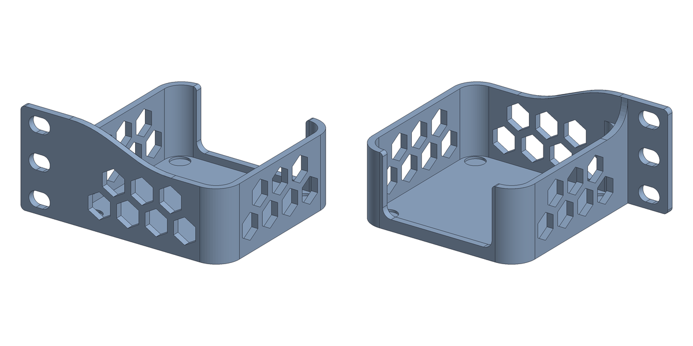

# Caseta rack mount

A corner rack mount for a Lutron Caseta Smart Bridge (L-BDG2), in the style
of a Philips Hue Bridge corner mount: an open tray with hexagon windows,
whose front wall carries on past one side as a 1U ear.

The ear screws to a rack post, and the tray sits beside the post. A wide
notch in the tray's back wall lets the power and Ethernet cables out, and
dimples in the floor take the bridge's rubber feet. The ear stands a full rack unit tall over the screws, then curves down to the walls.

## Status

The first print, sized from Lutron's spec sheet (69.9 mm square, with 1.5 mm
around it), was loose, and its notch blocked the Ethernet port. This version
is sized from the bridge itself but has not been printed yet.

The bridge measures 69.5 mm square and 30.2 mm tall. The pocket allows 0.5 mm
around it, and the walls come up to its top. Its base has a 7.5 mm rubber
foot in each corner, 1.5 mm in from both edges and about 1 mm proud; each
sits in an 8.5 mm dimple 1 mm deep, which locates the bridge and lets it rest
on the floor.

The Ethernet port's near side is 10 mm in from the bridge's edge and its
bottom 8 mm up. The port is off to one side, and the right-hand mount mirrors
the left, so the notch is symmetric: 51.5 mm wide, clearing the port by 1 mm
on either hand. Its bottom corners are rounded off below the port. The
micro-USB power port is centred and lower, well inside the notch.

The bridge's corner radius has not been measured. The pocket's corners have
an 8 mm radius, which with 0.5 mm of clearance needs the bridge's corners to
be rounded about 6.5 mm or more; the test piece checks this.

The ear's slots, wall thicknesses and window pattern match the Hue mount, so
this mount should fit wherever that one does. The slots are 10 x 7 mm, at the
EIA-310 hole heights (6.35, 22.225 and 38.1 mm up the unit), 10 mm out from
the side of the tray. The Hue mount's wall tops are lightly rounded; these
are square.

## Outputs

`make caseta-rack-mount` writes, in `build/`:

- `caseta-rack-mount.stl` and `.step`: the left-hand mount, with three
  slots. Seen from the front, the ear is on the left of the tray.
- `caseta-rack-mount-right.stl` and `.step`: its mirror image.
- `caseta-rack-mount-2-hole.stl` and `-right-2-hole`: both hands with only
  the top and bottom slots.
- `caseta-rack-mount-test.stl` and `.step`: the back 18 mm of the tray, with
  the notch, the back corners and two dimples. The same for either hand.

## Before printing

Print the test piece and set the bridge's back into it, its feet in the
dimples. Check that the back corners do not bind, and that an Ethernet cable
and the power cable plug in without touching the wall.

## Printing

Print floor down, with no supports. The slots are 7 mm tall and bridge
cleanly. PETG, like the rack.
