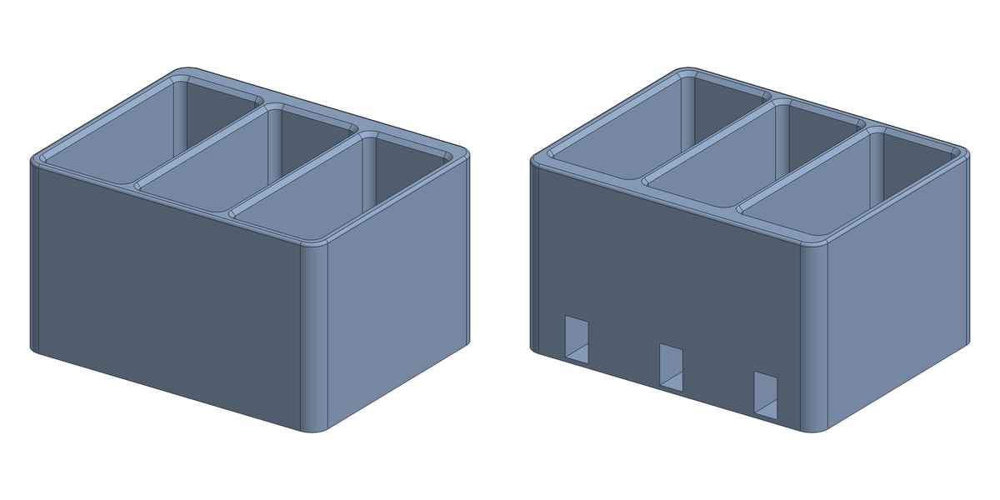
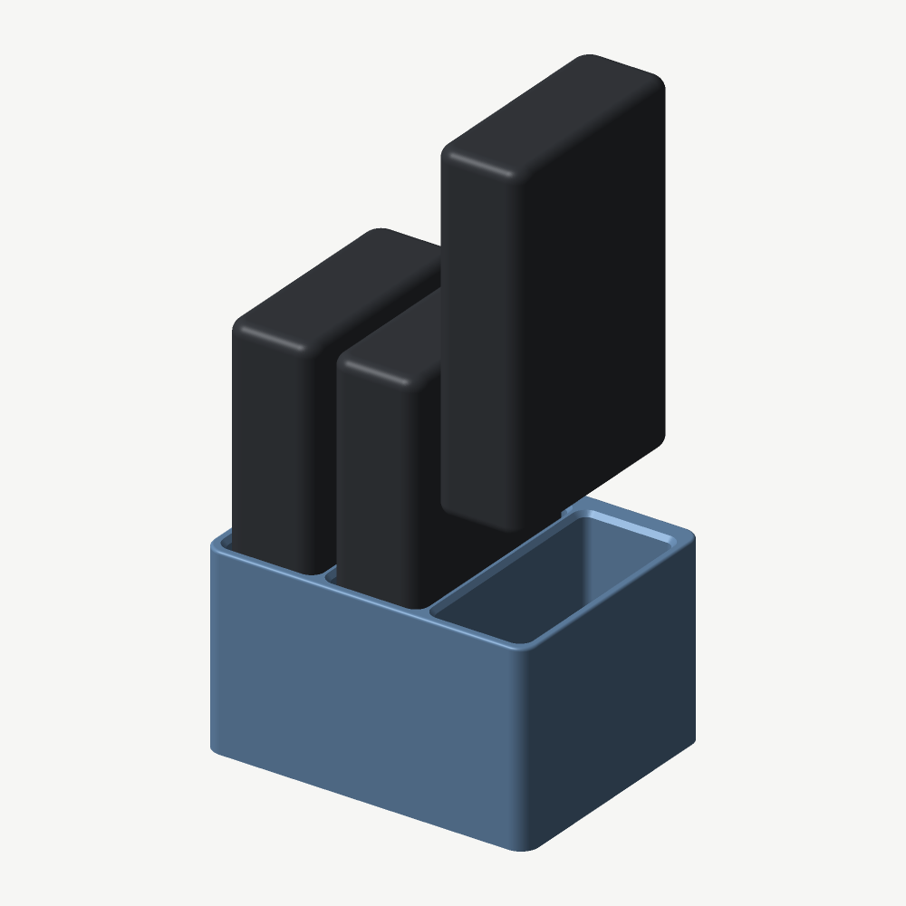
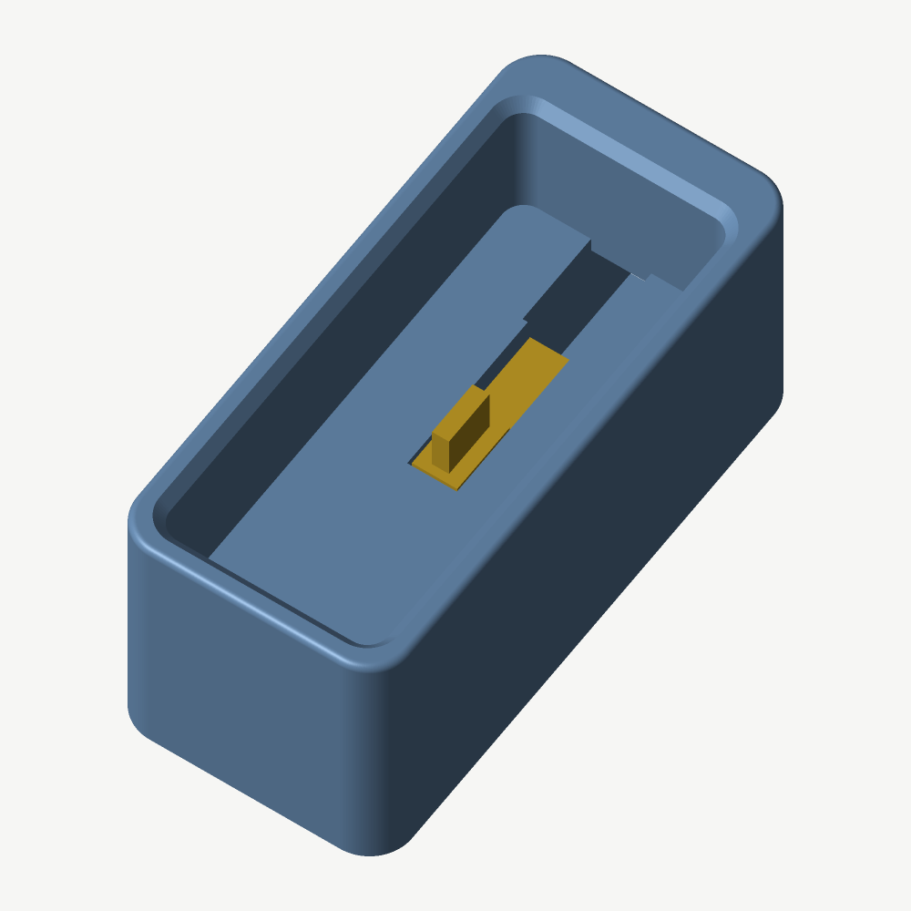

# Power bank dock

A desk dock that charges three
[Amazon Basics 20,000 mAh power banks](https://www.amazon.com/dp/B0FFM4BY6C)
at once. The banks stand on their port ends in a row, broad faces together.
Each slides down a slot onto a USB-C plug set into the slot's floor, and comes
to rest on the floor, so the floor takes its weight and the plug only makes the
connection.

The renders below show the adapters in gold. The cutaway runs through the
middle slot's plug.

| Two docked, one lifted out | From above | Cutaway |
| --- | --- | --- |
|  |  |  |

The one-slot dock, for testing an adapter, cable and bank before printing all
three:

## Status

Not yet printed. The dock is 108 x 85 x 63 mm. The banks stand 45 mm deep in
their slots, leaving about 69 mm of each above the walls to grab.

The bank measures 72.5 x 30.0 x 114.2 mm. Its ports sit on a panel flush with
the end face: USB-A, then two USB-C. The dock charges through the nearer USB-C
port, 40.4 mm from the USB-A edge, so each bank goes in with its USB-A port
toward the front, as the label on each slot's floor shows. A bank put in
backwards lands on plain panel between its ports, where the plug cannot catch.
Under the other USB-C port, a reversed bank would sit half over the USB-A port.

Across the thickness the port sits 0.75 mm off centre, toward the broad face
without the charge LEDs: 13.7 mm from that face and 15.2 mm from the LED face.
With USB-A toward the front, the LED face is on the right, judged from the
product photos, so each plug sits 0.75 mm left of its slot's centre.

A first test print, at 0.4 mm clearance all round and 10 mm tall, let the bank
rock front to back. The slots now have 0.2 mm clearance per side front to back
and 0.4 mm across the thickness.

The bank's corner radius was not measured. The slots' corners, at 3 mm, are
kept well under what the photos show, so that the flat faces locate the bank.

## Outputs

`make power-bank-dock` writes, in `build/`:

- `power-bank-dock.stl` and `.step`: the dock.
- `power-bank-dock-clearance-test.stl` and `.step`: a 10 mm tall block with a
  slot at each of 0.2, 0.3, 0.4 and 0.5 mm clearance per side, labelled and
  open top and bottom.
- `power-bank-dock-single.stl` and `.step`: a dock with one slot and 20 mm
  walls, 39 x 85 x 38 mm, otherwise identical to the full dock: the same
  floor, adapter pocket, cable channel and tunnel. Its walls are tall enough
  to guide a bank onto the plug and hold it upright.

## Hardware

- Three Silkland right-angle USB-C adapters, male to female: a flat L,
  24 x 21 x 6.4 mm. From the bottom up, a 12 mm body, a 2.5 mm collar round
  the plug's root and 6.5 mm of plug. The plug's centre is 5.5 mm from the
  body's front end, and the female socket's centre 5.5 mm above its bottom.
- Three USB-C to USB-C cables, not yet chosen. The tunnel through the back
  wall takes a straight plug whose overmould fits within 8.5 x 14 mm.
- A USB-C charger with at least three ports.
- Stick-on rubber feet for the flat underside.

Each adapter drops into its pocket from above, plug up and female end facing
back, and rests on the pocket's bottom. Its collar then sits 0.3 mm below the
floor, so the plug reaches 6.2 mm into a bank's port. Hot-glue it in place
along the pocket's sides, not underneath, where glue would lift the plug. To
line the plug up with the port, glue it with a bank seated on it: the pocket
leaves 0.3 mm each side for the adapter to move. The cable plugs into the
adapter through the tunnel and stays removable.

## Before printing

1. Optionally print the clearance test and push a bank through each slot. The
   tightest slot it slides through without forcing gives `CLEARANCE_X` and
   `CLEARANCE_Y`.
2. Print the one-slot dock and glue in an adapter. Drop a bank in, USB-A toward
   the label, and check that:
   - it slides onto the plug and sits flat on the floor. If it rests on the
     plug instead, the port is not where the model puts it: check
     `PORT_FROM_EDGE`, and which face the port is nearer;
   - it charges through a cable plugged in at the back;
   - it doesn't rock front to back.
3. Print the full dock.

## Printing

PLA or PETG, printed upright with the floor on the bed. Nothing needs supports:
the pockets and channels open upward, and the tunnels' roofs bridge 8.5 mm.
