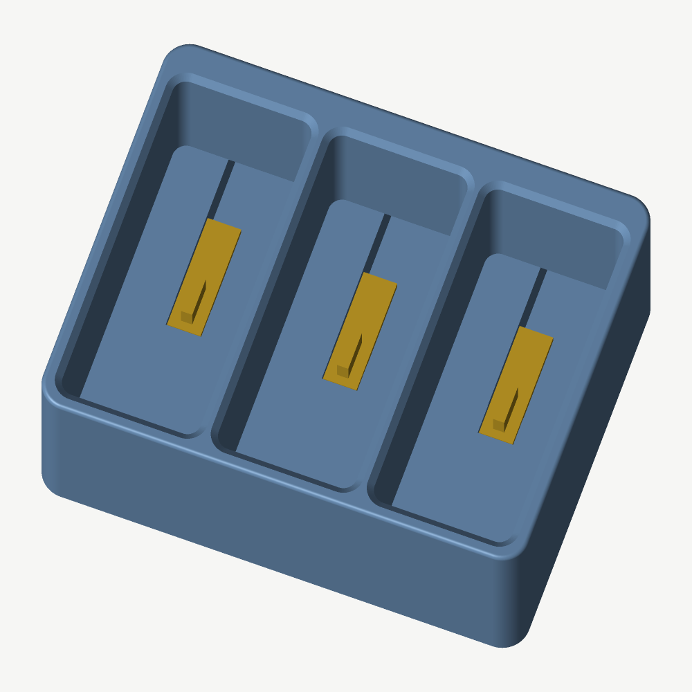
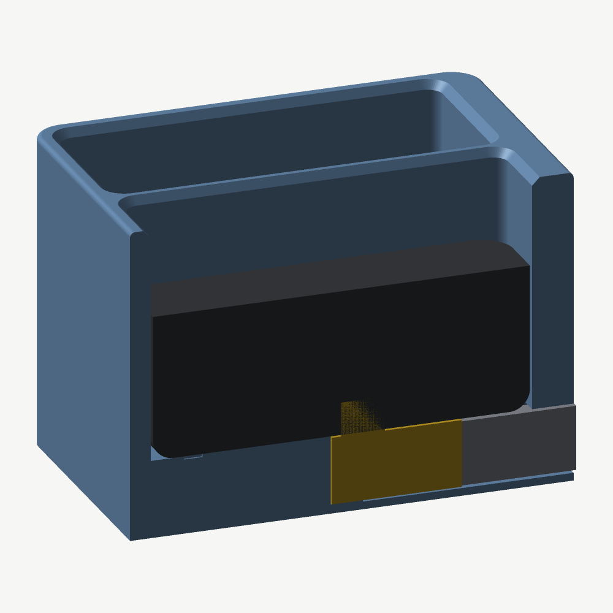
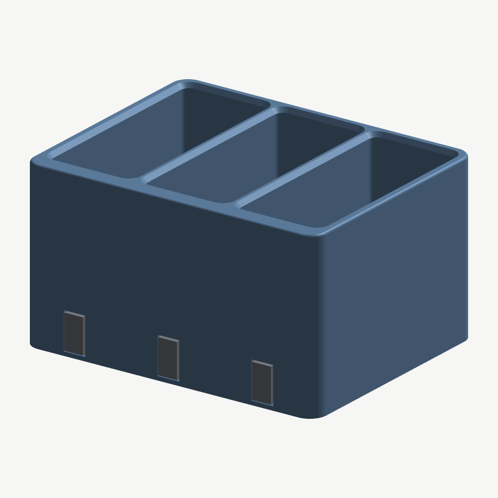

# Power bank dock

A desk dock that charges three
[Amazon Basics 20,000 mAh power banks](https://www.amazon.com/dp/B0FFM4BY6C)
at once. The banks stand on their port ends in a row, broad faces together.
Each slides down a slot onto a USB-C plug set into the slot's floor, and comes
to rest on the floor, so the floor takes its weight and the plug only makes the
connection.

The renders show placeholder adapters in gold and cable plugs in grey, at the
dimensions in the model. The cutaway runs through the middle slot's plug.

| From above | Cutaway | From behind |
| --- | --- | --- |
|  |  |  |

## Status

Not yet printed. The dock is 108 x 85 x 60 mm. The banks stand 45 mm deep in
their slots, leaving about 69 mm of each above the walls to grab.

The bank measures 72.5 x 30.0 x 114.2 mm. Its ports sit on a panel flush with
the end face, centred across the thickness: USB-A, then two USB-C. The dock
charges through the nearer USB-C port, 40.4 mm from the USB-A edge, so each
bank goes in with its USB-A port toward the front, as the label on each slot's
floor shows. A bank put in backwards lands on plain panel between its ports,
where the plug cannot catch. Under the other USB-C port, a reversed bank would
sit half over the USB-A port.

The bank's corner radius was not measured. The slots' corners, at 3 mm, are
kept well under what the photos show, so that the flat faces locate the bank.

**The adapter and cable dimensions are placeholders.** Replace them in
`power-bank-dock.py` with measurements from the real parts before printing the
dock.

## Outputs

`make power-bank-dock` writes, in `build/`:

- `power-bank-dock.stl` and `.step`: the dock.
- `power-bank-dock-clearance-test.stl` and `.step`: a 10 mm tall block with a
  slot at each of 0.2, 0.3, 0.4 and 0.5 mm clearance per side, labelled and
  open top and bottom.
- `power-bank-dock-slot-test.stl` and `.step`: the dock's middle slot, cut off
  10 mm above the floor, with its adapter pocket and cable tunnel.

## Hardware

- Three right-angle USB-C adapters, male to female, rated for 100 W / 5 A. The
  bend must lie within the plane of the plug's broad faces, so that the whole
  adapter is a flat L about as thick as the plug. The plug points up and the
  body runs toward the back. Buy three identical ones.
- Three short USB-C to USB-C cables, with straight plugs.
- A USB-C charger with at least three ports.
- Stick-on rubber feet for the flat underside.

Each adapter drops into its pocket from above, plug up, with its female end
facing back. Its cable's plug goes in through the tunnel in the back wall and
into the adapter. The cable plug's overmould sits under the tunnel's roof,
which keeps the adapter from lifting out when you pull a bank up. If it still
lifts, a dab of hot glue in the pocket will hold it.

## Before printing

1. Print the clearance test and push a bank through each slot. Choose the
   tightest one it slides through without forcing, and set `CLEARANCE` to that
   value.
2. Measure an adapter and a cable plug, and replace the placeholder dimensions.
   `ADAPTER_DROP` sets how far below the floor the adapter's top face sits; the
   plug's metal shell must still reach fully into the bank's port.
3. Print the slot test. Fit an adapter and cable, and drop a bank in to check
   that it seats on the plug and charges.

## Printing

PLA or PETG, printed upright with the floor on the bed. Nothing needs supports:
the pockets and channels open upward, and the tunnels' roofs bridge 8 mm.
